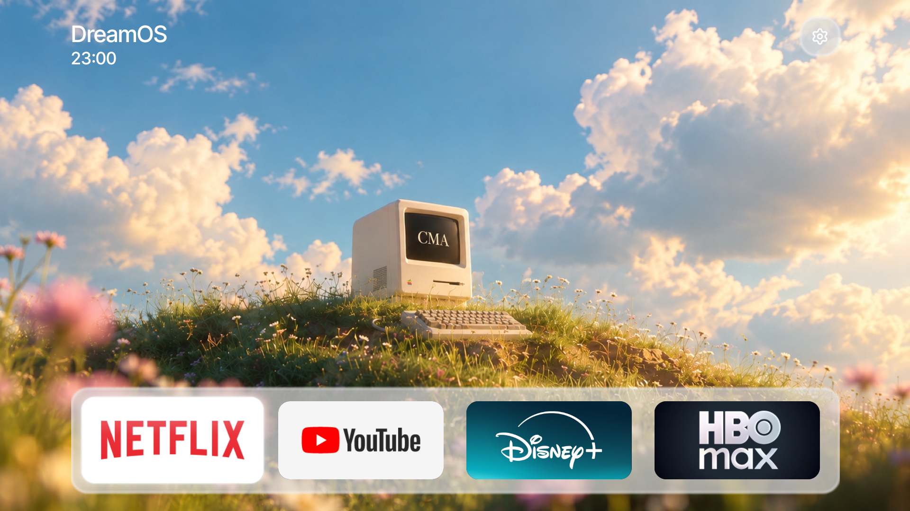
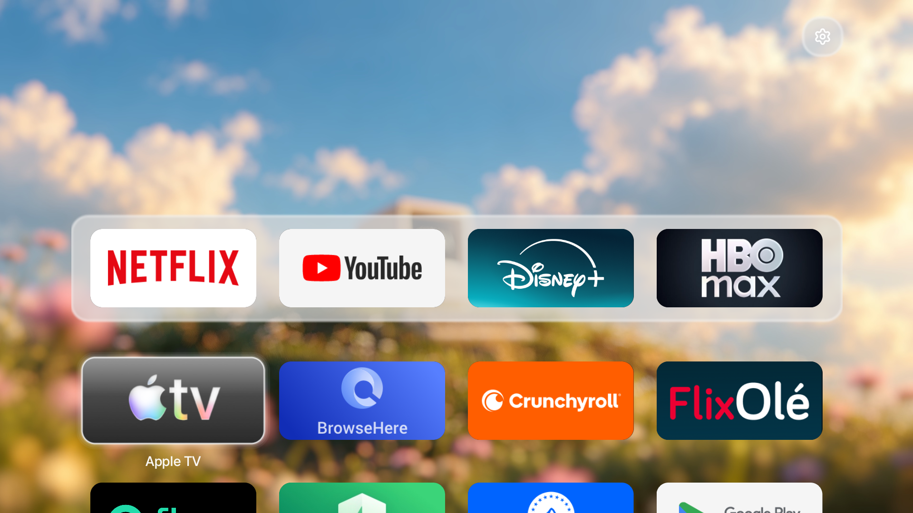

# DreamOS

Home: a photo wallpaper, "DreamOS" (Inter Tight Medium 48px) and the time (36px) at the top left, a glass
settings button (Lucide icon) at the top right, and four app tiles (349x165px, 25px corners) in a glass dock
(rgba(217,217,217,0.71), 2px white edge, 2px layer blur, 35px corners). Scrolling down to the app grid fades
in a bokeh-blurred copy of the photo (baked from the design's shader) and fades out the wordmark and clock.

Also: a "DreamOS" boot splash for 2.7 s with a startup sound, focus-move and select sounds, no-bounce focus
motion. Measured on a Mali-470 (Hitachi/TCL BeyondTV): CPU 5-9 ms per frame, GPU ~13-16 ms median.

Licences: code MIT (derived from cleanyourtv); Inter Tight under the SIL OFL 1.1 (`assets/FONT-LICENSE-INTER-TIGHT-OFL.txt`);
settings icon from Lucide (ISC). The wallpaper and the sounds are the owner's artwork: check their terms before
publishing them.
